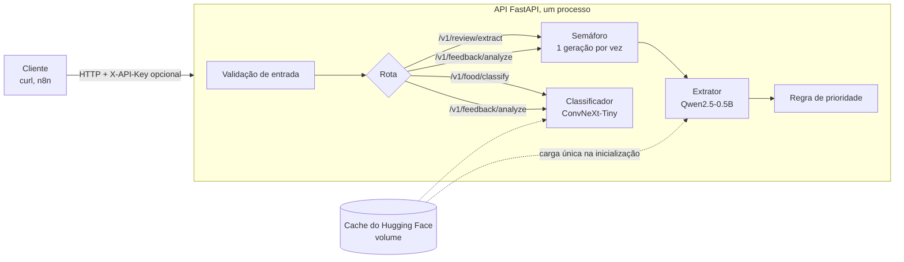

# API de análise de feedback

Uma API em FastAPI que serve dois modelos que eu treinei e publiquei no Hugging Face:

- um **extrator** que lê uma avaliação de cliente em português e devolve um JSON com sentimento, aspectos (entrega, produto, atendimento, preço), problema principal e se a empresa precisa agir ([aitalo/qwen2.5-0.5b-avaliacoes-ptbr](https://huggingface.co/aitalo/qwen2.5-0.5b-avaliacoes-ptbr));
- um **classificador** que recebe a foto de um alimento e diz qual é, entre 20 classes, ou recusa quando a confiança é baixa ([aitalo/convnext-tiny-comida-brasileira](https://huggingface.co/aitalo/convnext-tiny-comida-brasileira)).

Há também um endpoint que junta os dois: recebe o texto de um feedback e, opcionalmente, uma foto, e devolve a análise do texto, o prato identificado e uma prioridade de atendimento.

Tudo roda em CPU. Este é o terceiro projeto de uma sequência: os dois primeiros foram o treino de cada modelo ([pt-review-extractor](https://github.com/ItaloSLeao/pt-review-extractor) e [ml-image-classifier](https://github.com/ItaloSLeao/ml-image-classifier)); o próximo passo, fora deste repositório, é orquestrar esta API com n8n.

## Arquitetura



Os dois modelos são carregados uma vez, quando o processo sobe. A inferência roda em um pool de threads, fora do loop de eventos, para o `/health` continuar respondendo durante uma geração. O porquê de cada escolha está em [docs/decisoes.md](docs/decisoes.md).

## Como rodar

Na primeira subida a API baixa os modelos do Hub (cerca de 1,1 GB). Reserve também uns 3 GB de RAM livres: só os pesos do extrator em float32 ocupam perto de 2 GB (são cerca de 0,5 bilhão de parâmetros de 4 bytes).

### Com Docker

```bash
cp .env.example .env        # opcional; ajuste se quiser
docker compose up --build
```

A API fica em `http://127.0.0.1:8000`. O cache do Hugging Face vai para um volume nomeado (`hf-cache`), então recriar o contêiner não baixa os modelos de novo. Se você já tem os modelos no cache da sua máquina e quer reaproveitá-los, coloque no `.env`:

```
HF_CACHE=/home/SEU_USUARIO/.cache/huggingface
```

Se o Docker reclamar de permissão no socket (`permission denied ... docker.sock`), seu usuário não está no grupo `docker`. Rode com `sudo` ou adicione o usuário ao grupo (`sudo usermod -aG docker $USER`) e entre de novo na sessão.

### Sem Docker

Precisa de Python 3.12 ou mais novo (foi desenvolvido e testado no 3.14).

```bash
python3 -m venv .venv
source .venv/bin/activate
pip install --index-url https://download.pytorch.org/whl/cpu torch==2.15.0 torchvision==0.29.2
pip install -r requirements.txt -r requirements-dev.txt
uvicorn app.main:app --host 127.0.0.1 --port 8000
```

A primeira linha do `pip` instala o PyTorch só de CPU, que é bem menor que o pacote padrão. Para carregar variáveis de um `.env` sem Docker: `uvicorn app.main:app --env-file .env`.

A documentação interativa (Swagger) fica em `http://127.0.0.1:8000/docs`.

## Configuração

Tudo por variável de ambiente; veja [.env.example](.env.example). As principais:

| Variável | Padrão | Para quê |
|---|---|---|
| `API_KEY` | vazia | Se definida, as rotas `/v1/*` exigem o cabeçalho `X-API-Key`. O `/health` fica sempre aberto. |
| `TORCH_NUM_THREADS` | `0` | Threads do PyTorch. `0` deixa o PyTorch decidir. |
| `DEVICE` | `auto` | `auto` usa CUDA se existir (em fp16); sem GPU, CPU em float32. |
| `REPETITION_PENALTY` | vazia | Vazia mantém o valor do `generation_config.json` do modelo. Ver Limitações. |
| `CLASSIFIER_THRESHOLD` | vazia | Vazia usa o `limiar.json` publicado junto do modelo. |
| `HF_CACHE` | volume `hf-cache` | Só no Docker Compose: onde fica o cache dos modelos. |

## Endpoints

Se `API_KEY` estiver definida, acrescente `-H "X-API-Key: SUA_CHAVE"` aos exemplos de `/v1/*`.

### GET /health

```bash
curl http://127.0.0.1:8000/health
```

```json
{
  "status": "ok",
  "modelos": {"extrator": true, "classificador": true},
  "ambiente": {"cpu": "...", "nucleos_logicos": 12, "threads_torch": 10, "versoes": {"torch": "2.15.0+cpu", "...": "..."}}
}
```

Responde 200 quando os dois modelos estão carregados e 503 (com `"status": "degradado"`) quando algum falhou na carga.

### POST /v1/review/extract

```bash
curl -X POST http://127.0.0.1:8000/v1/review/extract \
  -H "Content-Type: application/json" \
  -d '{"texto": "Comprei duas unidades e só veio uma. Ninguém responde no SAC."}'
```

Formato da resposta (valores ilustrativos):

```json
{
  "valido": true,
  "sentimento": "negativo",
  "aspectos": {"entrega": "negativo", "produto": null, "atendimento": "negativo", "preco": null},
  "problema_principal": "falta de produto",
  "requer_acao": true,
  "saida_bruta": null,
  "latencia_ms": 6200.0
}
```

Quando o modelo gera algo que não é um JSON no esquema esperado, a resposta continua sendo 200, mas com `"valido": false`, os campos em `null` e o texto que o modelo produziu em `saida_bruta`. A falha fica visível para quem consome, em vez de virar um erro genérico ou um resultado inventado.

### POST /v1/food/classify

```bash
curl -X POST http://127.0.0.1:8000/v1/food/classify -F "imagem=@prato.jpg"
```

Formato da resposta (valores ilustrativos):

```json
{
  "classe": "arroz",
  "confianca": 0.87,
  "top3": [
    {"classe": "arroz", "confianca": 0.87},
    {"classe": "farofa", "confianca": 0.05},
    {"classe": "purê", "confianca": 0.02}
  ],
  "rejeitado": false,
  "latencia_ms": 85.0
}
```

Se a maior confiança ficar abaixo do limiar calibrado na validação, vem `"classe": null` e `"rejeitado": true`; o `top3` continua na resposta.

### POST /v1/feedback/analyze

```bash
curl -X POST http://127.0.0.1:8000/v1/feedback/analyze \
  -F "texto=A marmita chegou fria e faltou o feijão. Quero meu dinheiro de volta." \
  -F "imagem=@prato.jpg"
```

Formato da resposta (valores ilustrativos):

```json
{
  "analise_texto": {"valido": true, "sentimento": "negativo", "aspectos": {"...": "..."}, "problema_principal": "...", "requer_acao": true, "saida_bruta": null},
  "prato": {"classe": "arroz", "confianca": 0.87},
  "prioridade": "alta",
  "latencia_ms": 8100.0
}
```

`imagem` é opcional. `prato` vem `null` quando não há imagem ou quando o classificador a rejeitou. A regra de `prioridade` está em [docs/regras.md](docs/regras.md).

### Erros de entrada

| Situação | Resposta |
|---|---|
| `texto` ausente, vazio ou com mais de 2000 caracteres | 422 |
| Arquivo que não é imagem, corrompido, truncado ou vazio | 422 |
| Imagem em formato diferente de JPEG, PNG ou WEBP | 415 |
| Imagem maior que 5 MB | 413 |
| `X-API-Key` ausente ou errada (quando `API_KEY` está definida) | 401 |
| Modelo não carregado | 503 |

Todo erro vem como `{"detail": "mensagem em português"}`. O formato da imagem é decidido pelo conteúdo do arquivo, aberto com Pillow, e não pelo `Content-Type` que o cliente informa.

Cada resposta traz um cabeçalho `X-Request-ID`, que é o mesmo `id` que aparece no log. O log registra só id, rota, status, latência e tamanhos. O texto das avaliações e as imagens nunca são gravados.

## Testes

```bash
pytest            # rápidos: usam dublês no lugar dos modelos, não baixam nada
pytest -m slow    # integração: carrega os modelos reais (download na primeira vez)
```

Os testes rápidos cobrem validação de entrada, regra de prioridade, saída inválida do extrator, imagem corrompida, autenticação, a garantia de uma geração por vez e a ausência do texto do cliente nos logs.

## Scripts

Com a API rodando:

```bash
python scripts/smoke.py       # 5 avaliações, 2 imagens e 1 feedback completo; imprime respostas e latências
python scripts/benchmark.py   # 20 chamadas por endpoint; grava results/latencia.json e atualiza a tabela abaixo
```

Os dois aceitam `--url` e leem `API_KEY` do ambiente. As imagens de exemplo são baixadas do repositório do classificador no Hub para `.cache/`.

## Latência

<!-- latencia:inicio -->
| Endpoint | Chamadas | p50 (ms) | p95 (ms) |
|---|---|---|---|
| `POST /v1/review/extract` | 20 | pendente | pendente |
| `POST /v1/food/classify` | 20 | pendente | pendente |

Pendente: rode `python scripts/benchmark.py` com a API no ar. O script grava `results/latencia.json` e reescreve esta tabela com os números medidos, a CPU e as versões usadas.
<!-- latencia:fim -->

## Limitações

- **Só CPU, e é lento para texto.** O extrator é um modelo de linguagem gerando token a token; cada avaliação leva segundos. A classificação de imagem é bem mais rápida. Os números medidos ficam na tabela acima.
- **Uma geração por vez.** Requisições de extração simultâneas entram em fila. Dez chamadas ao mesmo tempo significam que a última espera as outras nove. Não há limite de fila nem tempo máximo de espera na API; quem chama deve configurar o próprio timeout.
- **O extrator foi treinado só com avaliações de e-commerce** (Olist). Feedback sobre comida, restaurante ou delivery está fora do domínio de treino: o modelo responde, mas a qualidade ali não foi medida. Os aspectos também são os do e-commerce (entrega, produto, atendimento, preço).
- **O extrator às vezes devolve JSON inválido.** No teste do projeto de origem isso aconteceu em 4,4% das avaliações. Um caso que observei aqui: em "O produto é bom, mas a entrega atrasou uma semana." o modelo omitiu os aspectos que seriam `null`. Com `REPETITION_PENALTY=1.0` essa mesma avaliação saiu válida, mas isso é um exemplo isolado, não uma medição; o padrão continua sendo o valor com que o modelo foi avaliado (1.1). Trocar o padrão pede reavaliar no conjunto de teste do projeto de origem.
- **O classificador foi treinado com recortes de alimentos sobre fundo preto.** Em fotos comuns de prato, com mesa, talheres e vários alimentos juntos, o desempenho não foi medido e deve ser pior.
- **São 20 classes.** Qualquer coisa fora delas é forçada para uma das 20 ou rejeitada. A rejeição mede baixa confiança; ela não detecta "isto não é comida".
- **Sem lote nem streaming**, e a autenticação é uma única chave compartilhada. Serve para demonstração e para uma rede local, não para exposição direta na internet.

## Licenças dos dados

Os dois modelos carregam as condições dos dados em que foram treinados.

- **Extrator.** Treinado em um dataset derivado do *Brazilian E-Commerce Public Dataset by Olist*, sob CC BY-NC-SA 4.0. O uso é **não comercial**.
- **Classificador.** Treinado no conjunto *Brazilian food images*, sob CC BY 4.0, que exige atribuição: Carvalho, Marcos Alberto (2023), "Brazilian food images", Mendeley Data, V2, doi: [10.17632/7n36jtcpv3.2](https://doi.org/10.17632/7n36jtcpv3.2). As imagens de exemplo que os scripts baixam vêm desse conjunto.

Por causa da licença dos dados do extrator, este projeto como um todo é de estudo e portfólio.

## Código reaproveitado

- `app/review_common.py` foi copiado de `src/common.py` do [pt-review-extractor](https://github.com/ItaloSLeao/pt-review-extractor) (commit `531d55b`): prompt de sistema, montagem das mensagens e validação do JSON.
- `app/classifier.py` foi adaptado de `src/predict.py` do [ml-image-classifier](https://github.com/ItaloSLeao/ml-image-classifier) (commit `9427523`): pré-processamento, top-3 e rejeição por limiar.

## Mais documentação

- [docs/regras.md](docs/regras.md): regra de prioridade e regras de validação.
- [docs/decisoes.md](docs/decisoes.md): decisões de projeto e o que ficou de fora.
